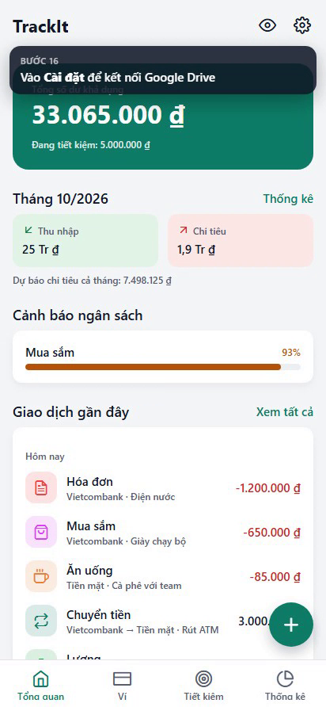
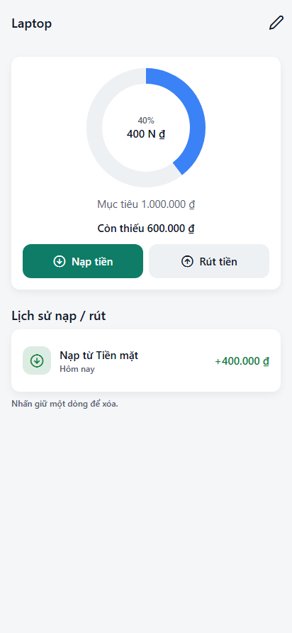
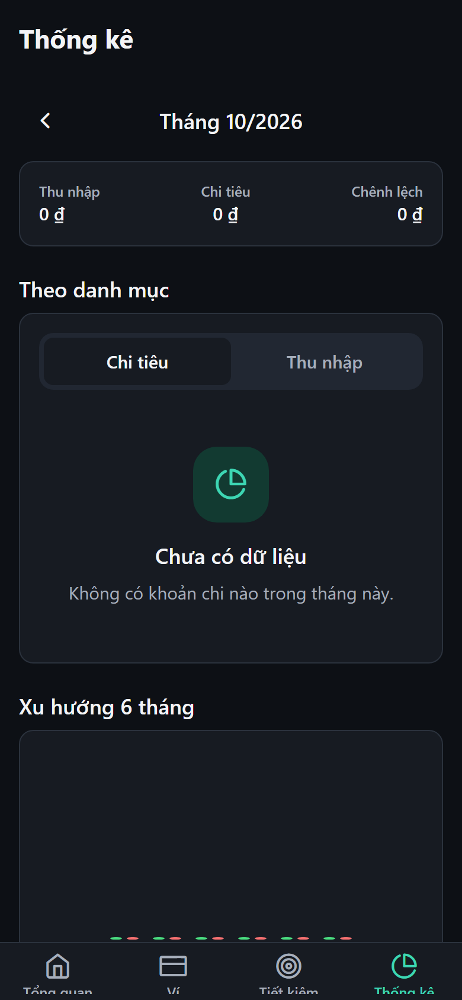

# TrackIt — Personal Finance (React Native / Expo)

Track wallets, savings goals, budgets and spending statistics, with offline-first sync to a JSON file in **your own Google Drive**.

| Dashboard | Savings goal | Stats (dark) |
| --- | --- | --- |
|  |  |  |

🎬 **Tutorial video:** [`docs/TrackIt-demo.mp4`](docs/TrackIt-demo.mp4) (2 min, Vietnamese captions; WebM original in `docs/TrackIt-demo.webm`)

## Features

- **Ví (Wallets)** — cash, bank, e-wallet, credit card; balances are *derived* from the ledger so they never drift. Wallets with history are archived instead of deleted.
- **Giao dịch (Transactions)** — expense / income / transfer between own wallets (transfers don't count as spending). Search, filter by month & type.
- **Tiết kiệm (Savings)** — goals with target + deadline; deposits/withdrawals move real money from/to wallets; shows the monthly amount needed to hit the deadline.
- **Thống kê (Stats)** — income vs expense, donut by category, 6-month trend, month-over-month change, per-category **monthly budgets** with 80 % / 100 % warnings, burn-rate month-end forecast.
- **Google Drive sync** — one file at `My Drive/TrackIt/trackit-data.json`; per-record last-write-wins merge with tombstones so multiple phones stay consistent.
- Light/dark/system theme, privacy mode (hide balances), VND/USD/EUR display, JSON export.

## Run it

Requires Node 20+. Google Sign-In uses native code, so it needs a **development build** (not Expo Go).

```bash
npm install --legacy-peer-deps
cp .env.example .env.local          # fill in Google client IDs (see below)
npx expo run:android                # or: npx expo run:ios (macOS) / npx eas-cli@latest build --profile development
```

Quick UI preview without native tooling (Drive sync disabled on web):

```bash
npx expo start --web
```

Quality checks:

```bash
npm test            # domain unit tests (money, balances, stats, merge)
npm run typecheck
npm run lint
```

## Google Drive setup (one-time)

1. [Google Cloud Console](https://console.cloud.google.com/) → create a project → **APIs & Services → Library** → enable **Google Drive API**.
2. **OAuth consent screen** → External → add scope `.../auth/drive.file` → add yourself as a test user.
3. **Credentials → Create OAuth client ID**:
   - **Web application** → copy to `EXPO_PUBLIC_GOOGLE_WEB_CLIENT_ID`.
   - **Android** → package `com.terralogic.trackit` + SHA-1 of your debug/release keystore (`cd android && ./gradlew signingReport`, or `npx eas-cli credentials`).
   - **iOS** → bundle ID `com.terralogic.trackit` → copy to `EXPO_PUBLIC_GOOGLE_IOS_CLIENT_ID`, and its *reversed* ID to `EXPO_PUBLIC_GOOGLE_IOS_URL_SCHEME`.
4. Rebuild the dev client (`npx expo prebuild --clean && npx expo run:android`).

`drive.file` means TrackIt can only see files **it created** — never the rest of your Drive.

## Architecture

```
src/
  app/            Expo Router screens — (tabs)/ index·wallets·savings·stats, modals: transaction, wallet/, goal/, budget/
  domain/         Pure TypeScript, fully unit-tested
    types.ts        Data model (money = integer minor units, every record Syncable)
    money.ts        Parse/format amounts per currency (no floats)
    finance.ts      Balances, summaries, category breakdown, budgets, forecast
    merge.ts        Drive conflict resolution (LWW per record + tombstones)
    migrate.ts      Schema validation/upgrades for files read from Drive
  store/          Zustand + AsyncStorage (data.ts synced, prefs.ts device-only)
  services/       googleAuth (native + .web stub), googleDrive (REST v3), sync engine
  components/     Design system (ui, form, states, charts, finance widgets)
  theme/          Tokens: 4-pt spacing, type scale, light/dark colours, elevation
scripts/demo/     Playwright smoke test + tutorial-video recorder (web build)
```

**Sync flow:** app always reads/writes locally → after edits (4 s debounce), on launch and on foreground: download Drive file → merge → re-check file `version` (retry if another device wrote meanwhile) → upload → apply. Works fully offline; failures show a friendly retry banner.

## Tutorial (matches the video)

1. **Ví → +** tạo ví "Vietcombank", loại *Ngân hàng*, số dư ban đầu 15.000.000.
2. **Tổng quan → +** ghi *Thu* 25.000.000 (Lương) vào Vietcombank.
3. *Chuyển* 3.000.000 Vietcombank → Tiền mặt (rút ATM — không tính là chi tiêu).
4. Ghi các khoản *Chi*: Ăn uống, Mua sắm, Hóa đơn.
5. **Tiết kiệm → +** mục tiêu "Mua MacBook" 35.000.000 trong 12 tháng → mở mục tiêu → **Nạp tiền** 5.000.000.
6. **Thống kê** xem biểu đồ theo danh mục → **Đặt ngân sách** Mua sắm 700.000/tháng.
7. **Tổng quan** hiện cảnh báo ngân sách + dự báo chi tiêu; nhấn 👁 để ẩn số dư.
8. **Cài đặt** → *Kết nối Google Drive* để sao lưu/đồng bộ; đổi giao diện *Tối*.

### Re-recording the video

```bash
npx expo start --web                 # terminal 1
cd scripts/demo && npm run setup     # once
npm run record                       # → scripts/demo/video/TrackIt-demo.webm
npm run smoke                        # screenshots of every screen, light + dark
```
